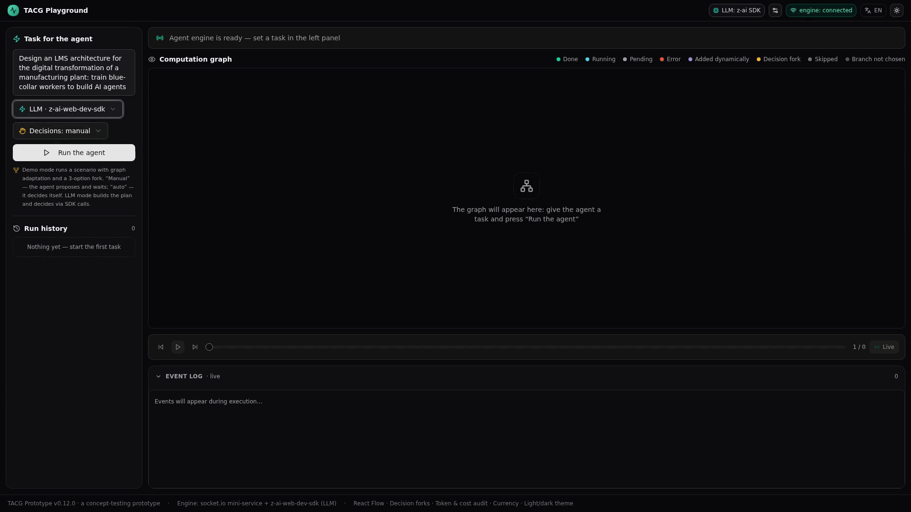
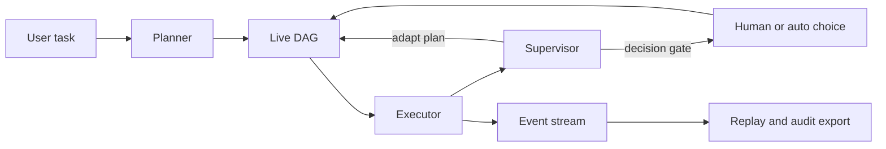

# Avizis — Transparent Agent Computation Graph
<a href="https://youtube.com"><kbd>📺 YouTube Demo Video</kbd></a>

**Interactive debugger and execution playground for AI agents.** Visualize an LLM agent's plan as a live DAG, inspect every step, pause execution, steer decision branches, override node outputs, replay runs, and export an auditable Markdown trail.

> **Status:** working concept prototype for AI-agent transparency, human-in-the-loop control, and reproducible execution. Not production-ready yet.




## Why Avizis

Most AI-agent observability tools help you inspect traces after a run. Avizis explores a complementary workflow: **understand and influence an agent while it is running**.

- **See the plan** — the agent turns a task into a directed acyclic graph (DAG).
- **Watch execution** — nodes and edges update as steps run and the plan adapts.
- **Stay in control** — pause, stop, retry, override outputs, or choose a decision branch.
- **Recompute safely** — downstream nodes are recalculated after an intervention.
- **Replay any run** — event-sourced history supports timeline scrubbing and graph versions.
- **Audit behavior** — export decisions, interventions, model provenance, and LLM usage to Markdown.
- **Bring your own model** — use the default provider or an OpenAI-compatible endpoint.

## Use Cases

| User | Job to be done |
|---|---|
| AI-agent engineers | Debug plans, branching logic, prompts, and expensive steps |
| Product and UX teams | Prototype where an agent should decide and where it should ask |
| AI consultants | Demonstrate agent behavior and deliver a reviewable run artifact |
| Educators | Teach agent planning, adaptation, and human-in-the-loop workflows visually |

## How It Works



A run follows a transparent loop: **plan → execute → inspect → adapt or ask → continue → replay**. Every structural change and user intervention becomes an event that can be folded back into the run state.

## Core Capabilities

| Capability | What Avizis provides |
|---|---|
| Live computation graph | React Flow DAG with node states, animated edges, versions, zoom, and minimap; executor steps stream live — node badge and inspector show the text as the model writes it |
| Human-in-the-loop control | Pause/resume/stop, manual or automatic decisions, mixed branch selection |
| Node intervention | Inspect inputs and outputs, retry a node, override its result, recompute descendants |
| Adaptive planning | Supervisor can add steps or decision gates as new information appears |
| Time-travel replay | Event-sourced timeline, snapshots, graph version switching, run history |
| Audit artifacts | Markdown export with chronology, branches, interventions, model provenance, and usage |
| BYOK routing | Default provider, OpenAI-compatible endpoints (OpenAI, OpenRouter, Groq, Ollama, LM Studio, vLLM), and native provider APIs — Anthropic Messages and Google Gemini generateContent (keys via x-api-key / x-goog-api-key, streaming supported) |

## Quick Start

### Prerequisites

- [Bun](https://bun.sh/)
- A modern browser
- Optional: an API key or local OpenAI-compatible endpoint for LLM mode

### Run locally

```bash
git clone [https://github.com/danku13/Avizis.git](https://github.com/danku13/Avizis.git)
cd Avizis
bun install
bun run dev
```

In a second terminal:

```bash
cd mini-services/avizis-agent
bun --hot index.ts
```

Open `http://localhost:3000`. The web UI runs on port `3000`; the agent engine uses Socket.IO on port `3003`.

> Start with **Demo mode** to explore Avizis without an LLM key.

## Architecture

```text
Next.js / React 19 / React Flow / Zustand
                  │ Socket.IO
                  ▼
       Bun agent mini-service
 planner → executor → supervisor → decisions
                  │
                  ▼
       RunEvent[] + fold → replay / audit
```

Main locations:

| Area | Path |
|---|---|
| UI and graph components | `src/components/avizis/` |
| Client logic and types | `src/lib/avizis/` |
| Runtime state | `src/store/avizis-store.ts` |
| Agent engine | `mini-services/avizis-agent/` |
| Product and architecture docs | `docs/` |
| E2E scenarios and screenshots | `scripts/` |

## Documentation

| Document | Purpose |
|---|---|
| [Product requirements](./docs/prd/PRD.md) | Problem, users, scenarios, scope, and limitations |
| [Functional requirements](./docs/fr/index.md) | Capability-level requirements and status |
| [Architecture decisions](./docs/adr/index.md) | ADRs and technical rationale |
| [Product and market hypotheses](./docs/product/PRODUCT-001-capabilities-market.md) | Segments, value propositions, and validation hypotheses |
| [Change log](./docs/cr/index.md) | Requirement and architecture changes |

## Current Limitations

Avizis is a concept prototype, not a production agent orchestrator. It currently has no production authentication or multi-user collaboration, stores run history in local JSON, and does not yet provide a hardened persistent database or enterprise deployment model.

## Roadmap

- Shareable runs and multi-user review
- Production persistence and authentication
- Multi-run comparison and experiment workflows
- Integration adapters for existing agent runtimes

## Contributing

Issues, architecture feedback, and reproducible agent-debugging scenarios are welcome. Before opening a pull request, review the [requirements](./docs/fr/index.md) and [architecture decisions](./docs/adr/index.md).

## License

No open-source license has been selected yet. Until a license is added, the repository remains publicly viewable but all rights are reserved by default.
